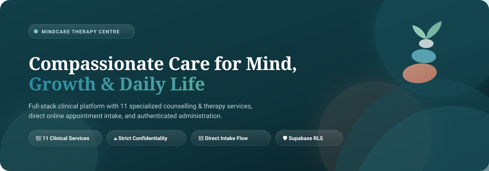
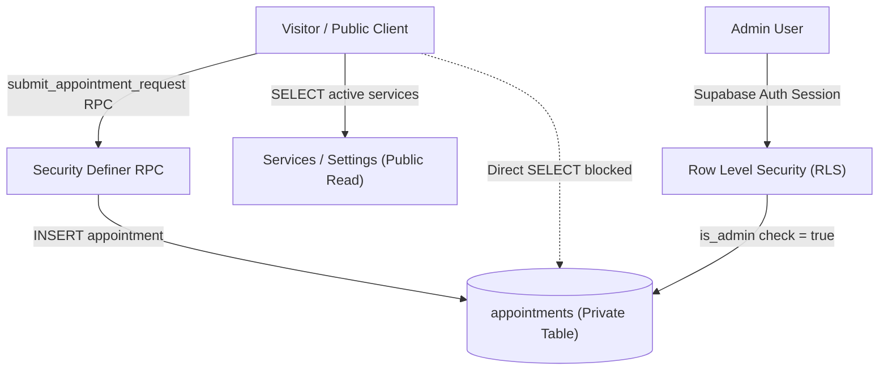

<p align="center">
  
</p>

<h1 align="center">🌿 MindCare Therapy Centre</h1>

<p align="center">
  <strong>Compassionate, evidence-informed counselling, therapy, and rehabilitation for individuals, children, and families.</strong>
</p>

<p align="center">
  <a href="#-tech-stack"></a>
  <a href="#-tech-stack"></a>
  <a href="#-tech-stack"></a>
  <a href="#%EF%B8%8F-supabase-database--security-rls"></a>
  <a href="#-testing--quality-assurance"></a>
  <a href="#-testing--quality-assurance"></a>
  <a href="#-privacy-seo--clinical-standards"></a>
</p>

---

## 📑 Table of Contents

- [🌟 Overview](#-overview)
- [🏥 Clinical Service Directory (11 Services)](#-clinical-service-directory-11-services)
- [🎨 Design Language & Palette 2](#-design-language--palette-2)
- [🛠️ Tech Stack](#%EF%B8%8F-tech-stack)
- [✨ Core Capabilities](#-core-capabilities)
  - [🌐 Public Patient Experience](#-public-patient-experience)
  - [🔐 Authenticated Administration](#-authenticated-administration)
- [📁 Project Architecture](#-project-architecture)
- [⚡ Quick Start & Installation](#-quick-start--installation)
- [🗄️ Supabase Database & Security (RLS)](#%EF%B8%8F-supabase-database--security-rls)
- [🧪 Testing & Quality Assurance](#-testing--quality-assurance)
- [🚢 Production Deployment](#-production-deployment)
  - [☁️ Cloudflare Pages](#%EF%B8%8F-cloudflare-pages)
  - [▲ Vercel](#-vercel)
- [🔒 Privacy, SEO & Clinical Standards](#-privacy-seo--clinical-standards)
- [📄 License & Ethics](#-license--ethics)

---

## 🌟 Overview

**MindCare Therapy Centre** is a modern, single-page clinical web application designed for a multidisciplinary mental health and rehabilitation clinic. Built with **React 18**, **Tailwind CSS**, and **Supabase**, it provides an empathetic, unhurried patient intake journey paired with a secure administrative command center.

Patients can explore **11 specialized clinical services**, review evidence-informed approaches, learn what to expect at their first visit, and submit structured appointment requests—all without requiring a physician's referral.

Administrative staff enjoy a password-protected dashboard to review appointment requests, manage service catalogs, configure clinic hours, and manage specialist rosters—safeguarded by strict database **Row Level Security (RLS)** policies.

---

## 🏥 Clinical Service Directory (11 Services)

The clinic organizes care across two complementary wings: **Counselling & Psychotherapy** and **Therapy & Rehabilitation**. Every service features bespoke vector artwork, transparent first-visit roadmaps, and detailed FAQs.

| Service | Category | Target Audience | Key Focus Areas |
| :--- | :--- | :--- | :--- |
| **👶 Child Counselling** | Counselling | Children & Caregivers | Emotional expression, school adjustment, worries & social confidence |
| **💍 Pre-Marital Counselling** | Counselling | Couples preparing for marriage | Communication expectations, shared values & constructive dialogue |
| **❤️ Marital Counselling** | Counselling | Married partners | Conflict resolution, life stage changes, rebuilding intimacy & trust |
| **👨‍👩‍👧‍👦 Family Counselling** | Counselling | Families & caregivers | Family dynamics, recurring disputes, parenting support & transition periods |
| **🌅 Old Age Counselling** | Counselling | Older adults & families | Life transitions, loneliness, bereavement & personal meaning |
| **✋ Occupational Therapy** | Rehabilitation | Children & adults | Fine motor development, sensory integration & everyday autonomy |
| **🗣️ Speech Therapy** | Rehabilitation | Children & adults | Articulation, language delays, fluency & social communication |
| **📚 Special Education** | Rehabilitation | School-age children | Individualized educational plans, literacy & cognitive learning support |
| **🧭 Behavioral Management**| Rehabilitation | Children, teens & parents | Emotional regulation, positive routines & classroom behavior strategies |
| **🧠 Cognitive Management** | Rehabilitation | Adults & seniors | Focus, working memory, problem-solving & executive function |
| **🏠 ADL Training** | Rehabilitation | Individuals building independence | Dressing, feeding, grooming, personal hygiene & home mobility |

---

## 🎨 Design Language & Palette 2

MindCare employs **Palette 2**—a calming, healthcare-informed color system crafted to inspire safety, warmth, and clinical trust:

```
┌────────────────────────────────────────────────────────────────────────┐
│  Palette 2 Clinical Color System                                      │
├──────────────────┬─────────────────┬──────────────────┬────────────────┤
│ Marine Slate     │ Seafoam Teal    │ Soft Cream       │ Sage Accent    │
│ #123F49          │ #1E6B7B         │ #F7FAFA          │ #55745E        │
│ Deep grounding   │ Primary brand   │ Warm serene      │ Balance &      │
│ text & headers   │ actions & focus │ canvas & cards   │ natural growth │
├──────────────────┴─────────────────┴──────────────────┴────────────────┤
│ Warm Terracotta: #F1A388  ·  Primary Soft: #E2EBE8  ·  Line Border: #D8E2D9│
└────────────────────────────────────────────────────────────────────────┘
```

- **Serif Display Heading**: `DM Serif Display` for trustworthy, empathetic typography.
- **Sans-Serif Body**: `DM Sans` for high legibility across all viewport sizes.
- **Human-Centric Vector Artwork**: Bespoke React SVG illustrations for every clinical discipline—zero generic stock photography.
- **Zero White Voids**: Cards and hero illustrations integrate transparent backdrops and gentle dual-color glows.

---

## 🛠️ Tech Stack

- **Frontend Core**: [React 18](https://react.dev/) + [React Router 7](https://reactrouter.com/) (SPA architecture)
- **Build & Dev Tool**: [Vite 8](https://vite.dev/) with lightning-fast HMR and minified chunks
- **Styling**: [Tailwind CSS 3](https://tailwindcss.com/) with extended clinical design tokens
- **Icons**: [Lucide React](https://lucide.dev/) (consistent, accessible SVG iconography)
- **Forms & Validation**: [React Hook Form](https://react-hook-form.com/) + custom clinic validators
- **Backend & Database**: [Supabase](https://supabase.com/) (PostgreSQL 15, Auth, PostgREST & RPC functions)
- **Security**: PostgreSQL **Row Level Security (RLS)** & security definer RPCs
- **Testing**: [Vitest 5](https://vitest.dev/) + [Testing Library](https://testing-library.com/) (26 automated tests) + [ESLint 10](https://eslint.org/)

---

## ✨ Core Capabilities

### 🌐 Public Patient Experience
- **Empathetic Hero & Reassurance**: Sanctuary SVG illustration, zero-pressure starting point explorer, and ethical care commitments.
- **Clinical Service Detail Pages**:
  - Breadcrumb navigation & consultation quick-facts (`50–60 Min`, `Age-Adapted`, `Private`, `Direct Booking`).
  - Responsive 2-column clinical architecture with checkmarked focus cards.
  - Transparent 3-step first visit timeline (`Welcoming Intake` $\rightarrow$ `Gentle Exploration` $\rightarrow$ `Clear Care Plan`).
  - Interactive FAQ accordions with accessible `<details>` controls.
- **Direct Appointment Intake**:
  - Accessible booking form with client-side and server-side validation.
  - Multi-service preselection from service detail pages.
  - Immediate reference code generation upon submission.
- **Full-Screen Mobile Navigation**:
  - Native drawer overlay (`fixed inset-0`) with background scroll locking.
  - Direct telephone (`tel:`) and WhatsApp click-to-chat integration.
  - Sticky bottom contact bar for phone, WhatsApp, and booking access on mobile.

### 🔐 Authenticated Administration
- **Admin Authentication**: Email/password sign-in verified via Supabase Auth with database role verification (`is_admin()` check).
- **Appointment Queue**:
  - Filter by status (`Pending`, `Confirmed`, `Completed`, `Cancelled`).
  - Full-text search across reference codes, client names, and notes.
  - Appointment details drawer with status update workflow.
  - Secure CSV export (sanitized fields only: reference, client name, service, date, status).
- **Service & Specialist Catalog**:
  - Toggle service visibility and manage service descriptions.
  - Manage practitioner profiles, credentials, and specialties.
- **Clinic Settings**:
  - Live configuration of clinic telephone, WhatsApp number, physical address, and operating hours.

---

## 📁 Project Architecture

```
mindcare-clinic/
├── public/
│   ├── images/
│   │   ├── mindcare-banner.svg      # SVG README & open graph banner
│   │   └── counselling-session.webp # Clinical session imagery
│   ├── _redirects                   # SPA routing for Cloudflare Pages
│   ├── robots.txt                   # Search crawler directives
│   └── sitemap.xml                  # Public search index sitemap
├── src/
│   ├── components/
│   │   ├── admin/                   # Admin navigation, tables & modals
│   │   ├── home/                    # HeroIllustration & sanctuary art
│   │   ├── layout/                  # Header, Footer, MobileActionBar, Layout
│   │   ├── services/                # ServiceIllustration (11 SVGs), ServiceCard, Group
│   │   └── ui/                      # Button, Dialog, Form controls
│   ├── config/                      # Site settings & WhatsApp URL generator
│   ├── data/                        # Offline fallback data (services, specialists)
│   ├── hooks/                       # usePageMetadata & custom utilities
│   ├── lib/                         # Supabase client & ClinicDataContext
│   ├── pages/                       # Home, Services, ServiceDetail, About, Specialists,
│   │                                # Contact, Appointment, AdminDashboard, Legal
│   ├── App.jsx                      # Route definitions
│   ├── index.css                    # Global typography & design system tokens
│   └── main.jsx                     # Application bootstrap
├── supabase/
│   ├── migrations/                  # Schema, RLS policies & RPC functions
│   ├── seed.sql                     # Seed catalog & clinic defaults
│   └── tests/                       # SQL security & RLS assertion suite
└── tests/                           # 26 Vitest public & admin test suites
```

---

## ⚡ Quick Start & Installation

### 1. Prerequisites
- **Node.js**: v20.x or v22.x+ (Node 24 supported)
- **Package Manager**: npm v10+

### 2. Clone & Install
```bash
git clone https://github.com/your-username/mindcare-clinic.git
cd mindcare-clinic
npm ci
```

### 3. Configure Environment Variables
Create a `.env.local` file in the root directory:

```env
VITE_SUPABASE_URL=https://your-project-ref.supabase.co
VITE_SUPABASE_ANON_KEY=your-public-anon-key
```

> [!NOTE]
> If Supabase credentials are not provided, the application automatically runs in **Offline Fallback Mode**, presenting full local catalog data and informational placeholders.

### 4. Start Development Server
```bash
npm run dev
```
Open [http://localhost:5173](http://localhost:5173) in your browser.

---

## 🗄️ Supabase Database & Security (RLS)

The platform is designed around the principle that **the database, not the frontend, enforces authorization**:



### Database Setup Steps:
1. In your Supabase project's **SQL Editor**, run:
   - `supabase/migrations/0001_init.sql` (Creates schema, tables, RLS policies, and RPC)
   - `supabase/migrations/0002_admin_appointment_instructions.sql`
2. Populate seed catalog data:
   ```bash
   # Run supabase/seed.sql once in SQL Editor
   ```
3. Disable public signups in **Supabase Auth → Settings**.
4. Invite your administrator email through the Supabase Dashboard.
5. Grant admin privileges:
   ```sql
   insert into public.admin_users (user_id)
   select id from auth.users where email = 'admin@yourclinic.com'
   on conflict (user_id) do nothing;
   ```

---

## 🧪 Testing & Quality Assurance

MindCare includes a test suite covering public routes, appointment validation, accessible landmarks, keyboard navigation, and admin protection:

```bash
# Run one-shot test suite (26 tests)
npm run test:run

# Run test watcher
npm test

# Run code style & lint check
npm run lint

# Production build check
npm run build
```

### Test Coverage Summary:
- ✅ **Route Integrity**: Validates all 11 service paths, About, Specialists, Contact, and Legal routes.
- ✅ **Form Validation**: Asserts appointment error boundaries and required field handling.
- ✅ **Accessibility (A11y)**: Focus trapping on modal dialogs, Escape key dismissal, and labeled landmarks.
- ✅ **Admin Route Protection**: Ensures unauthenticated visitors are redirected to `/admin/login`.
- ✅ **Structured Data**: Verifies `LocalBusiness` JSON-LD schema injection.

---

## 🚢 Production Deployment

### ☁️ Cloudflare Pages
1. Connect repository to **Cloudflare Pages**.
2. **Build Settings**:
   - Framework preset: `Vite`
   - Build command: `npm run build`
   - Build output directory: `dist`
3. **Environment Variables**: Add `VITE_SUPABASE_URL` and `VITE_SUPABASE_ANON_KEY`.
4. The included `public/_redirects` ensures seamless SPA routing for direct URLs.

### ▲ Vercel
1. Import repository into **Vercel**.
2. Vercel automatically detects the Vite framework and applies `vercel.json` routing rules.
3. Configure `VITE_SUPABASE_URL` and `VITE_SUPABASE_ANON_KEY` under **Project Settings → Environment Variables**.
4. Set production URL under Supabase **Authentication → URL Configuration**.

---

## 🔒 Privacy, SEO & Clinical Standards

- **Ethical Patient Privacy**: Submitted appointment requests cannot be read or retrieved by the public role or browser sessions.
- **Search Engine Optimization**: Dynamic page metadata titles, descriptions, and semantic HTML5 landmarks for all public routes.
- **LocalBusiness Structured Data**: Validated Schema.org JSON-LD to assist discovery by local search engines.
- **Accessibility Standards**: Meets WCAG 2.1 AA guidelines with keyboard navigability, high-contrast text, and screen-reader skip links.

---

## 📄 License & Ethics

Distributed under the **MIT License**. Created with care for therapists, counsellors, and healthcare providers dedicated to patient wellbeing.
